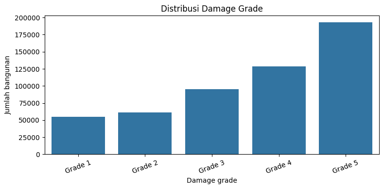
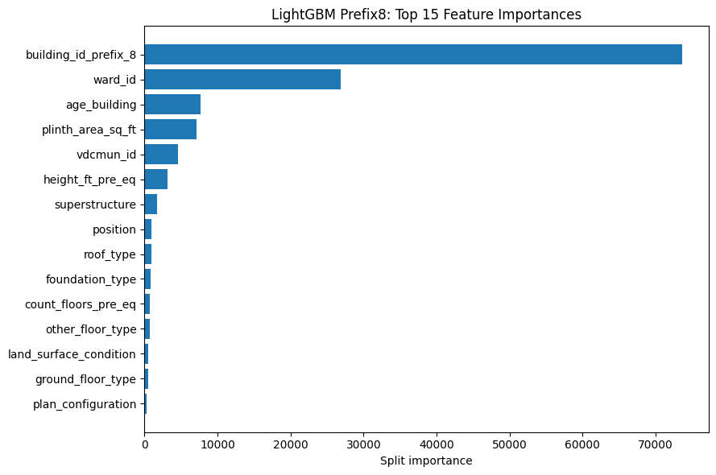

# Structural Damage Classification

Kompetisi Kaggle klasifikasi tingkat kerusakan bangunan (`damage_grade`). Proyek ini
berisi EDA, perbandingan model klasik, CatBoost, LightGBM, investigasi struktur
`building_id`, dan submission final. Metrik validation utama adalah **Macro F1**.

Model final menggunakan: **LightGBM multiclass + `building_id_prefix_8`**,
`class_weight="balanced"`, 200 trees, `random_state=42`, tanpa probability adjustment.

## Menyiapkan proyek di VS Code

1. Unduh atau clone repository lalu buka folder proyek di VS Code.
2. Gunakan Python 3.13 (versi yang dipakai saat verifikasi) dan buat virtual environment (terminal di folder proyek):

   ```bash
   python -m venv .venv
   ```

   Aktifkan di Windows PowerShell:

   ```powershell
   .\.venv\Scripts\Activate.ps1
   ```

   Pada macOS/Linux: `source .venv/bin/activate`.

3. Instal dependensi:

   ```bash
   python -m pip install -r requirements.txt
   ```

   Pilih interpreter `.venv` sebagai kernel Jupyter di VS Code.

4. Dari halaman **Data** kompetisi Kaggle, unduh dataset. Taruh empat file CSV
   berikut di `data/raw/`:

   ```text
   data/raw/
   ├── train.csv
   ├── test.csv
   ├── sample_submission.csv
   └── metadata.csv
   ```

   Link kompetisi: https://www.kaggle.com/t/a9196b92680b4492aeb06aeaee94f654
   `metadata.csv` adalah referensi penjelasan fitur; tiga CSV lainnya digunakan oleh notebook.
   Jika menggunakan `raw.zip`, ekstrak folder `raw/` ke `data/`.

## Urutan notebook

- **`notebooks/01_eda.ipynb`**: pemeriksaan data, distribusi target,
  nilai khusus `age_building=999`, dan hubungan fitur dengan kelas. Tidak perlu GPU.
- **`notebooks/02_modeling.ipynb`**: split 80:20 stratified, baseline, tuning,
  CatBoost, LightGBM, interaksi fitur, prefix ID, evaluasi, dan final training.
- **`notebooks/03_submission.ipynb`**: memuat pipeline final dari `models/`;
  jika belum ada, melatih ulang **hanya LightGBM final**, lalu menyimpan
  `submissions/submission_prefix8_original.csv`.

Jalankan notebook dari atas ke bawah. Notebook mengenali working directory baik di
root repository maupun di folder `notebooks/`. Jika ingin **hanya membuat submission**,
cukup jalankan `03_submission.ipynb` setelah data dan dependensi tersedia.

### Pilihan eksekusi di `02_modeling.ipynb`

```python
RUN_BASELINES = False
RUN_CLASSICAL_TUNING = False
RUN_CATBOOST = False
RUN_LGBM_EXPERIMENTS = False
RUN_FINAL_TRAINING = True
```

Ubah flag ke `True` hanya untuk eksperimen yang hendak dijalankan.
`RUN_CLASSICAL_TUNING=True` memerlukan `RUN_BASELINES=True`.
CatBoost tetap memakai konfigurasi **GPU**. Pastikan GPU NVIDIA
dan instalasi CUDA/driver yang kompatibel tersedia jika mengaktifkannya.
Random Forest, Decision Tree, dan LightGBM dapat dijalankan dengan CPU.

## Struktur folder

```text
notebooks/           Analisis, eksperimen, submission
scripts/             Preprocessing, feature engineering, training, prediksi
data/raw/            Tempat CSV Kaggle (ignore Git)
models/              Pipeline final yang disimpan (ignore Git)
submissions/         Output submission (ignore Git)
reports/figures/     Grafik yang diambil dari output notebook asli
reports/             Catatan audit dan hasil verifikasi
```

## Metode dan interpretasi

- `damage_grade` memiliki lima kelas dengan distribusi tidak seimbang.
- Fitur numerik: jumlah lantai, umur bangunan, luas dasar, dan tinggi bangunan.
  Kode distrik, wilayah, dan ward diperlakukan sebagai fitur kategorikal.





## Reproducibility dan batasannya

Split dan seed, nilai hyperparameter, label mapping Grade 1–5 → 0–4,
kategori berdasarkan kemunculan pada data fit, zero-padding ID menjadi 12 digit,
dan output kelas 1–5 tetap sama dengan sumber. Prefix/category yang tidak ditemukan
saat transform menjadi missing, sesuai cara awal menggunakan `pd.Categorical`.
Versi dependensi dipasang secara spesifik di `requirements.txt` sesuai lingkungan
pengujian Python 3.13. Perbedaan perangkat dan sistem operasi masih dapat
menimbulkan perbedaan; lihat catatan pada `reports/verification.md`.

`sample_submission.csv` berisi contoh teks `Grade 1`–`Grade 5`, tetapi kode submission
asli menghasilkan **integer 1–5**. Repository mempertahankan format numerik aslinya.
Periksa aturan format Kaggle sebelum upload. Data, model pkl, dan submission CSV tidak
ikut repo; file tersebut dibuat sendiri ketika notebook dijalankan.
Jangan jalankan eksperimen berat jika hanya ingin mengecek pembuatan submission.

Riwayat skor eksperimen dari notebook sumber tersedia di
[`reports/experiment_history.csv`](reports/experiment_history.csv). Nilainya
adalah hasil **historis**, bukan hasil training baru dari repository ini.
Entri percobaan `random_state=2026` yang ada di ZIP pembanding tidak dibawa
karena tidak ditemukan di `final_ketiga.ipynb` sebagai sumber utama.
Validasi submission menggunakan pesan error yang jelas tanpa mengubah prediksi.

Lihat [catatan refactoring](reports/refactoring_notes.md) dan
[hasil pengujian](reports/verification.md).

## Kesesuaian aturan tugas

- Dataset CSV tidak disertakan pada repository karena aturan ukuran dataset.
  `.gitignore` memuat `data/*.csv` sekaligus `data/raw/*.csv`. Dataset harus
  diunduh oleh pengguna dan diletakkan di `data/raw/`.
- `Pipeline` dan `ColumnTransformer` dipakai pada baseline serta tuning klasik.
  Pipeline native-category juga dipakai pada CatBoost dan semua eksperimen
  LightGBM. Model final memakai `FinalFeatureTransformer` dan LightGBM Prefix8.
- Seluruh function/class di `scripts/*.py` memiliki docstring.
- Tidak ada Neural Network.
- Hasil analisis, metrik historis, dan langkah menjalankan repository dijelaskan
  dalam notebook serta README ini.

## Fungsi tambahan pada scripts

`feature_engineering.py` menyediakan pembentukan `building_id_prefix`, penambahan
fitur prefix kategorikal, interaksi dua kategori, dan audit kelompok prefix.
Audit prefix di notebook modeling memanggil helper yang sama, tanpa mengubah
ukuran kelompok atau sumber kategori. `preprocess.py` juga memuat persiapan
CatBoost yang dipakai notebook dan validasi input CSV. `train.py` memiliki
helper baseline scikit-learn; konfigurasi dan penyimpanan LightGBM final tetap
menggunakan `train_final_lightgbm`, bukan helper eksperimen lain.

Fungsi tambahan tidak memaksa eksperimen berat berjalan. Flag `RUN_*` pada
`02_modeling.ipynb` tetap mengatur eksperimen, dan hanya `RUN_FINAL_TRAINING`
yang melatih serta menyimpan model final LightGBM.
